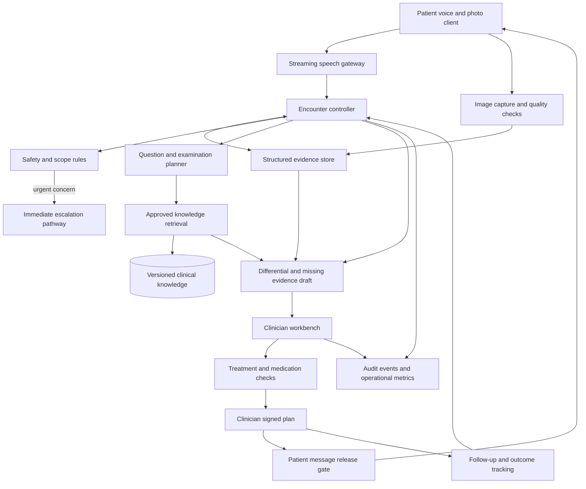

# Q-Doc: supervised voice OPD architecture

Design proposal • 8 November 2026 • India • adults • clinician-supervised dermatology first

This is a product and engineering proposal, not a validated clinical protocol. Companion: [dermatology knowledge design](DERMATOLOGY_KNOWLEDGE_DESIGN.md). No runtime behavior is changed by these documents.

Subsequent implementation update: the user prioritized breadth-first development. See [implemented draft coverage](IMPLEMENTED_CONDITION_COVERAGE.md) for the expanded catalog and current limitations; the proposal's one-condition-first sequencing is no longer the development priority.

## 1. Product decision

Build a voice-led consultation service that completes much of the work around a primary dermatology visit: history, appropriate photographs, evidence collection, clinician preparation, delivery of the clinician's signed plan, and follow-up. The clinician owns diagnosis, examination adequacy, investigations, prescriptions, and referral decisions. The service should be clear that the conversational assistant is AI.

The clinical unit is an **encounter with unresolved questions and a disposition**, not a predicted disease label. A successful encounter can end in a provisional differential, an examination request, or urgent escalation. It must not require a diagnosis to be considered complete.

India's published Telemedicine Practice Guidelines restrict AI/ML platforms from independently counselling or prescribing and describe their role in assisting RMPs. Use this as a design constraint; obtain an India-specific review of current applicable rules, intended use, and medical-device obligations before a clinical launch. Clinician approval must be substantive, not a cosmetic approval button. [NRCeS guidance](https://www.nrces.in/standards/telemedicine-practice-guidelines)

Voice is the interaction layer. Dermatology still needs visual information and sometimes palpation, sensation testing, dermoscopy, microscopy, or biopsy. Audio-only cases should remain eligible for intake and triage, while the clinician decides whether their evidence is adequate.

## 2. What the repository currently demonstrates

Inspected the current working tree, which already contains uncommitted work. Findings are scoped to the files inspected, not a full production audit.

| Evidence in repository | Consequence | Proposed change |
|---|---|---|
| `services/dialogue/consultation.py` has explicit consultation actions, fact status, clarification, and safety logic | Useful foundation for an encounter controller | Extend this structure instead of replacing it with an unrestricted chat agent |
| `condition_registry.py` has a mandatory confirmatory-test string for every condition | Tests can be presented as universally necessary even when clinically conditional | Represent indication, modality, diagnostic role, and limits separately |
| Registry names comedone extraction/dermoscopy for acne, patch testing/IgE for eczema, biopsy for psoriasis | Overly broad requirements need clinical correction | Audit each record against its exact source; see companion document |
| KB and treatment files claim guideline adherence but do not attach supporting citations to each recommendation | A guideline name does not establish that a specific instruction is supported | Versioned, reviewed claims and rules with source locations |
| `services/ml/classifier.py` constructs a network in its initializer without loading trained weights there | This path cannot be assumed to be a validated clinical classifier | Require a model artifact manifest, successful weight loading, validation provenance, and explicit unavailable state |
| `services/reasoner/engine.py` uses manually chosen multipliers | Its normalized scores are not established diagnostic probabilities | Call these ranking scores; measure calibration separately before any probability claim |
| `eval/benchmark.py` generates synthetic records with `multimodal_top` set to the condition label | Reported accuracy is demonstration behavior, not a measurement of real diagnostic inference | Keep simulation tests, add independent clinical evaluation |
| `eval/run_benchmarks.py` also generates synthetic benchmark inputs; sample image generator draws synthetic lesions | Dataset labels and simulated skin-tone groups do not prove performance on real Indian patients | Establish licensed, consented, patient-separated datasets and verified labels |
| Architecture documentation describes an eight-class scope, while a separate expanded registry exists | Clinical concepts can diverge across components | One canonical condition catalog, explicit aliases and release scope |

Do not reuse the existing 100% accuracy or voice-gain claims in a clinical pitch until they are supported by an independently reproducible evaluation. A change in model confidence is not a measured improvement in diagnostic correctness.

## 3. Recommended architecture

Start with a modular FastAPI application and background workers. Separate responsibilities in code and contracts first; do not start with a fleet of microservices or independently chatting agents.



The safety pathway runs before ordinary question planning and again after new evidence. It does not wait for image classification, retrieval, or full intake. Clinician-approved emergency scripts and local routing must be available when model providers fail.

### Component contracts

| Component | Allowed responsibility | Must not do |
|---|---|---|
| Speech gateway | VAD, transcription, language handling, timestamps, TTS, cancellation | Treat a fluent transcript as certain clinical evidence |
| Fact extractor | Propose typed facts tied to transcript spans | Convert silence or missing information into a negative finding |
| Encounter controller | Own state, tool permissions, transitions, retries, deadlines | Delegate final state transitions to model prose |
| Safety and scope service | Execute reviewed rules; identify missing safety answers | Let a high diagnostic score cancel an escalation |
| Question planner | Pick an approved question and explain its information need | Ask unlimited questions or gather irrelevant sensitive data |
| Image service | Quality, body-site/lesion linkage, observed morphology with uncertainty | Infer temperature, tenderness, sensation, or reliable palpation findings |
| Differential assistant | Rank hypotheses; list support, contradictions, and unknowns | Convert a forced closed-set winner into a diagnosis |
| Knowledge service | Retrieve approved claims by population, setting, indication, and version | Serve unreviewed web snippets into patient care |
| Treatment assistant | Produce a clinician-only draft and missing prerequisite list | Invent dose, duration, contraindication rules, or prescription authority |
| Release gate | Verify role, signature, evidence version, intended recipient, content type | Allow a clinician-approved plan to survive material evidence changes silently |
| Follow-up coordinator | Collect outcomes and adherence; flag deterioration | Automatically increase treatment or extend a prescription |

These are logical roles. Most can be ordinary code plus structured model calls. Use a second model selectively to identify contradictions; agreement between models is not independent clinical validation.

## 4. Encounter workflow

1. **Entry:** language preference, identity/session linkage, adult eligibility, consent, privacy explanation, communication needs, location needed for referral. Pregnancy and other special populations require an appropriate clinician pathway, not an automatic emergency label.
2. **Immediate safety screen:** brief, separately answerable questions; allow interruption by a concerning symptom at any time. Do not present a long routine intake first.
3. **Patient story:** let the patient describe the complaint, concern, duration, and desired help. Then confirm the clinically meaningful summary.
4. **Core history:** site, onset, evolution, itch/pain, individual lesion duration, spread, systemic symptoms, exposures, contacts, prior diagnoses, treatments, allergies and reactions, medications, relevant comorbidity, and daily impact.
5. **Adaptive history:** ask only questions likely to change disposition, distinguish plausible hypotheses, or establish a treatment prerequisite. Separate the duration of a rash episode from the duration of one lesion.
6. **Evidence capture:** overview, regional, and focused images when useful; optional help from a trusted person with consent. Request a retake only for a specific reason. If acquisition fails, move to clinician review or in-person care.
7. **Sufficiency check:** determine what is known, uncertain, conflicting, or impossible to assess remotely. Multiple simultaneous conditions are allowed.
8. **Clinician review:** show the concern, safety status, structured evidence, images, differential, missing examination, and sourced draft. The clinician may ask follow-up questions, arrange a video/examination, order tests, refer, or sign a plan.
9. **Plan delivery:** deliver the exact signed plan in text and voice, with validated translation. Teach-back checks understanding. A model must not add medication instructions during paraphrase.
10. **Follow-up:** collect response, adherence, adverse effects, new symptoms, and agreed comparison images. Reopen the encounter or create a linked one as appropriate. Record referral completion; a referral message alone is not a completed handoff.

Proposed states: `consent_pending → intake → evidence_pending → clinician_review → plan_signed → follow_up → closed`. Additional states: `urgent_escalation`, `awaiting_test`, `awaiting_in_person_exam`, `abandoned`, `provider_unavailable`. New evidence may invalidate a signed plan and return it to review. Urgent escalation can happen from any active state.

## 5. Evidence and uncertainty model

Store each observation with:

```text
observation_id, encounter_id, lesion_id, concept_id
value, unit, body_site, onset/effective_time
status: present | absent | unknown | not_asked | uncertain | conflicting
origin: patient_report | caregiver_report | clinician_exam | model_image | lab
source_turn_id/source_image_id/source_report_id, source_span
extraction_certainty, patient_confirmed, author, recorded_at, supersedes
```

Speech-recognition certainty, extraction certainty, image quality, diagnostic uncertainty, and treatment eligibility are different quantities. Keep them separate. A patient saying “it feels hot” is a report; it is not a clinician-measured finding. A fluent model response is not evidence.

For each hypothesis store `supporting_observation_ids`, `contradicting_observation_ids`, `missing_evidence`, `dangerous_alternatives`, `next_discriminator`, `knowledge_claim_ids`, and `status`. Use `considered`, `provisional`, `clinician_confirmed`, or `excluded_with_reason`. Avoid exposing arbitrary percentages to patients.

Unknown or unavailable evidence is not a negative result. When tests have imperfect sensitivity, their interpretation belongs in the condition pathway rather than a universal “negative means absent” rule.

## 6. Voice experience worth building

| Feature | Benefit | Acceptance example |
|---|---|---|
| Hindi/English code-switching and patient vocabulary | Understand ordinary symptom descriptions | Preserve the original phrase and confirm the clinical interpretation |
| Barge-in with playback cancellation | Patient can correct an answer immediately | Interrupted audio never resumes with stale advice |
| One question at a time | Better answers and lower cognitive load | “No” maps to one unambiguous question |
| Explicit confirmation of consequential facts | Reduce negation, medication, and number errors | Read back a drug name or uncertain allergy instead of guessing |
| Text fallback and assisted intake | Accessibility and poor-connectivity support | Resume the same encounter without duplicate facts |
| Body map and lesion timeline | Avoid mixing several problems | Two rashes can have different sites, durations, and images |
| Neutral, explainable questions | Reduce anchoring and leading answers | Explain why a question matters without announcing a diagnosis |
| Transparent waiting status | Avoid endless AI conversation | Explain clinician queue status and available next action |
| Teach-back | Assess comprehension | Patient explains when to use the signed plan and when to seek help |
| Private-image handling | Respect sensitive sites | Offer clinician examination instead of requiring an intimate photograph |

Suggested engineering targets, to measure rather than advertise: acknowledge input promptly, aim for roughly 2 seconds to a simple next question on a good connection, provide an honest progress indicator for longer work, and measure p50/p95 latency separately by language and network. Safety messages must not depend on completing a complex reasoning call.

## 7. Examination and image strategy

Maintain three explicit capabilities: patient-observable features, clinician-observable remote features, and in-person/test-dependent findings. A model can request appropriate images and describe uncertain visible morphology; it cannot manufacture a completed physical examination.

Capture body location, distribution, symmetry, morphology, surface, scale/crust, lesion size when a safe reference is available, hair/nail involvement, and temporal change. Camera checks should include focus, exposure, coverage, distance, and whether the relevant lesion is actually visible. Blur thresholds must be validated across devices; skin colour alone must not drive a malignancy or inflammation rule.

Do not ask patients to scrape, puncture, rub off scale to provoke bleeding, or test sensation using sharp/hot objects. Clinician-only procedures need their own instructions and consent. Preserve original images; never beautify or generatively enhance diagnostic images. If a crop is used, retain its link to the original and its transformation history.

## 8. Clinician workbench and medication safety

The first screen should answer: What is the patient worried about? Is this urgent? What evidence is reliable? What cannot be assessed? What decision is requested?

Show a short problem representation, complaint timeline, meaningful positives/negatives/unknowns, image gallery, medications/allergies, competing hypotheses, source-linked recommendations, and outstanding prerequisites. Clinician edits should update structured facts and preserve provenance. Store override reasons for later review, without automatically treating an override as ground truth.

Medication support needs structured generic ingredients, formulation, strength, route, dose units, frequency, duration, site restrictions, age/weight rules where relevant, pregnancy/lactation restrictions, renal/hepatic considerations, interactions, monitoring, duplication checks, and a local formulary version. These require curated clinical data; a general-purpose LLM is not a drug database. OTC status is jurisdiction-specific and does not by itself establish safety or suitability.

Before releasing a plan verify patient, current encounter version, prescriber identity and authority, clinical review, required evidence, contraindication resolution, and signature. Any material change to symptoms, allergy, pregnancy status, medication list, or test results requires explicit re-evaluation. Store the delivered text and audio rendition/version for audit.

## 9. Storage, APIs, operations, and security

Recommended initial stack: existing React client and FastAPI backend; PostgreSQL for encounters/knowledge/audit metadata; private object storage for images and consented audio; a background queue for transcription, summaries, ingestion, and follow-up. Add PostgreSQL vector search only when needed alongside structured and lexical retrieval. Redis is optional for short-lived queues/cache, not the source of clinical truth.

Core entities: Patient, Consent, Encounter, Lesion, Observation, MediaAsset, SafetyAssessment, DifferentialDraft, ClinicianReview, SignedPlan, Prescription, TestOrder/Result, Referral, FollowUp, KnowledgeRelease, AuditEvent. Preserve immutable signed versions and append corrections rather than rewriting history.

Proposed API contracts: encounter creation; event/turn submission; media upload completion; evidence correction; clinician draft generation; clinician decision/signature; patient-visible plan retrieval; follow-up submission. Use idempotency keys and encounter versions on mutations. Signed-plan endpoints require clinician authentication and role checks; browser flags or prompt text cannot grant this authority.

Protect all encounters with resource-level authorization; isolate tenants; use short-lived signed media URLs, encryption, managed secrets, audit access, documented retention/deletion, and verified backup restoration. Strip unnecessary EXIF/location data, restrict sensitive-image access, and minimize raw-audio retention. Separate care consent from any optional research/training consent. Avoid patient data in analytics and external web-search queries. Establish vendor data-use and retention terms before sending health information.

Patient text, uploaded reports, retrieved documents, and image text are untrusted inputs. They cannot alter tool permissions or release gates. Validate model schemas and identifiers server-side. Do not rely on a text sanitizer as the primary prescribing or safety control.

Operational fallbacks: unavailable STT → text/assisted intake; unavailable reasoning → clinician intake summary; unavailable KB → no new clinical recommendation draft; unavailable clinician → explicit queue/alternative care route; urgent concern → immediate approved escalation message. A failed component must not silently switch to an unvalidated model or pretend a clinician has reviewed the case.

Track queue age, escalation acknowledgement, failed handoffs, provider errors, stale knowledge use, invalid signatures, orphaned uploads, and lost follow-ups. Assign an accountable on-call owner and incident process before real use.

## 10. Evaluation that can support a clinical claim

Maintain separate tracks for software correctness, knowledge quality, speech accuracy, clinical decision support, and operational outcomes.

* **Software:** state transitions, retries, access control, stale-plan rejection, interrupted audio, conflicting observations, no-provider failures, and release-gate bypass attempts.
* **Knowledge:** citation support, population applicability, unsupported treatment details, expired releases, missing contraindications, translation fidelity, and source conflicts.
* **Speech:** clinically meaningful errors in negation, body site, timing, medication names, allergy, and severity; report by language/accent/noise. Word error rate alone is insufficient.
* **Clinical:** dangerous-condition escalation sensitivity, under-triage/over-triage, differential recall, unnecessary tests, unsafe plan proposals, coverage versus error, and abstention appropriateness. Report confidence intervals and denominators.
* **Equity:** actual collected data across relevant skin appearances, ages, devices, languages, and care settings. Fitzpatrick categories describe sun response and should not be treated as a complete photographic skin-colour measure.
* **Operational:** clinician review time, edit burden, missed follow-up, time to appropriate care, patient comprehension, and cost per completed reviewed encounter.

Use de-identified, appropriately consented real encounters with patient-level separation and a locked test set from a different site/time where feasible. Ground truth may require examination, tests, or follow-up; clinician agreement alone is not always sufficient. Resolve disagreement through documented independent adjudication. Do not include the same patient/image in train and test sets.

Compare clinician alone with clinician plus Q-Doc in a controlled study; compare image-only, history-only, and combined inputs on the same cases to measure actual incremental value. Synthetic vignettes remain useful for regression and rare safety scenarios but do not establish diagnostic accuracy.

Release gates are pre-specified by a clinical safety lead with a statistician. Do not invent a universal 70% confidence threshold. Determine sample sizes from the intended claim and acceptable uncertainty, especially for rare dangerous outcomes. Begin with offline evaluation, then prospective shadow mode, then a small supervised pilot with a kill switch and incident review.

## 11. Feature priorities and implementation sequence

| Stage | Deliverables | Exit evidence |
|---|---|---|
| 0: clinical foundation | Intended use, adult scope, named clinical owner, source ledger, demonstration-data labels | Approved scope and audit of existing claims |
| 1: reliable encounter | Observation provenance, safety transitions, multi-lesion capture, confirmation, basic clinician queue | End-to-end workflow and failure-path checks |
| 2: grounded dermatology | Reviewed initial condition pathways, versioned retrieval, cited differential and exam checklist | Clinical review and citation/evidence tests |
| 3: signed care delivery | Medication prerequisites, clinician sign-off, validated translation, teach-back, referral tracking | Demonstrated inability to release unsigned/stale plans |
| 4: prospective pilot | Real-case study, monitoring, follow-up, incident response | Pre-specified clinical and operational criteria met |
| 5: broader scope | Additional conditions and populations, clinic/EHR integration | Separate validation for each expansion |

High-value later features: clinician-requested follow-up questions, patient-held history, consented serial photographs, medication-pack transcription with confirmation, affordability/availability constraints, lab-result reconciliation, structured referral letters, and guideline-change impact reports.

Defer autonomous prescriptions, unrestricted general OPD diagnosis, broad biologic/systemic-treatment management, unvalidated cancer exclusion, and automatic learning from live clinical overrides. Each would need a distinct evidence and governance case.

## 12. Repository migration map

* Extend `services/dialogue/consultation.py` into the controller; preserve its useful explicit-action design.
* Evolve `services/dialogue/schemas.py` toward provenance-bearing observations and canonical condition IDs.
* Treat the three `services/clinical_knowledge/` modules as legacy draft content; migrate claim by claim rather than automatically blessing them.
* Add a `services/knowledge/` boundary for approved release loading and retrieval. Begin with simple structured queries; add search indexes later.
* Make `services/policy/` the non-bypassable server-side safety, scope, and release gate.
* Change reasoner outputs to evidence-linked provisional hypotheses; separate ranking scores from validated probabilities.
* Extend the existing clinician brief/review endpoints with authentication, substantive review, version binding, and signed-plan semantics.
* Separate `eval/` simulation artifacts from clinical datasets and reports; record model/data/knowledge versions in every evaluation.

First implementation slice: one complete, supervised acne encounter with evidence provenance, a reviewed knowledge card, clinician edits/signature, signed-plan delivery, and a follow-up event. Include urgent interruption and insufficient-evidence paths in the same slice. Expand only after the whole workflow works.
